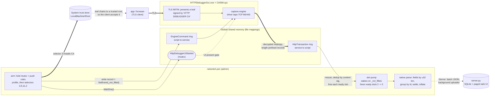
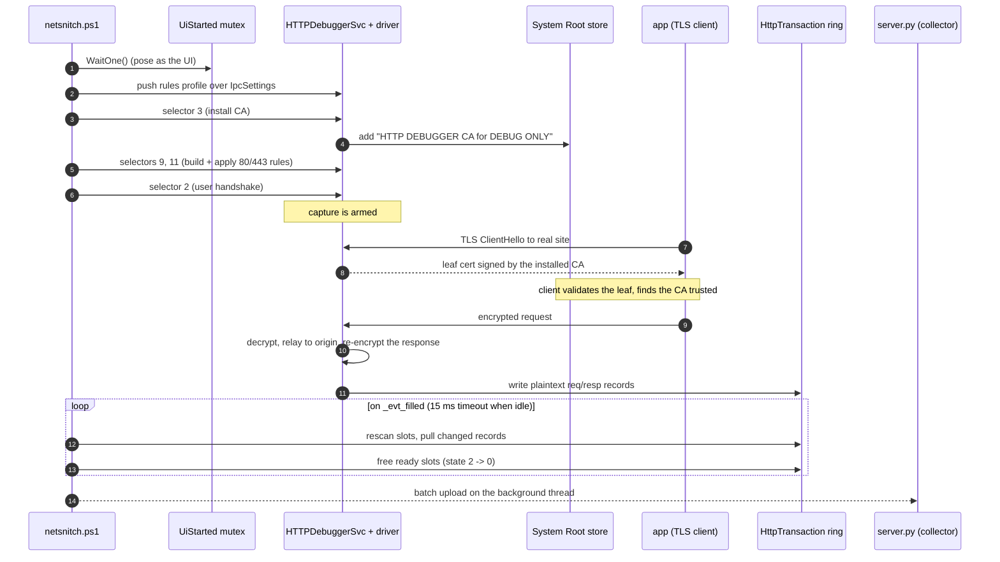

# NetSnitch

Headless HTTP/HTTPS traffic capture on Windows, driven entirely from a single
PowerShell script. It installs the HTTPDebugger capture service + its network
filter driver, **arms capture without any GUI**, and prints every transaction
(request headers, request body, response headers, and response body), decoding
HTTPS in the clear.

## Contents

| File | Purpose |
|------|---------|
| `netsnitch.ps1`   | Installer + headless activator + live reader (the agent) |
| `HTTPDebuggerSvc.exe`| The capture service (intercepts via a WFP/NetFilter driver) |
| `CtrlSM.sys`        | The network filter driver the service registers |
| `server.py`         | Optional collector server + web UI (receives captures from agents) |

## Requirements

- Windows 10/11 (x64)
- Administrator rights (the script self-elevates)
- Windows PowerShell 5.1 (built in)

## Usage

Run from an elevated prompt (or let it elevate itself):

```powershell
# Install the service + driver, arm capture, and stream transactions until Ctrl+C
.\netsnitch.ps1

# Capture for a fixed number of seconds
.\netsnitch.ps1 -Seconds 60

# Service already installed and running - just arm + read
.\netsnitch.ps1 -NoInstall

# Generate a few sample HTTP/HTTPS requests so there is something to show
.\netsnitch.ps1 -SelfTest -Seconds 30

# Trim long bodies to N characters (default 0 = show the whole body)
.\netsnitch.ps1 -TrimBody 2000

# Only capture/show/send specific domains (matches subdomains too)
.\netsnitch.ps1 -Domains google.com,github.com

# Run continuously in a hidden background process (returns immediately)
.\netsnitch.ps1 -Background -Server http://<collector-host>:8771

# Start automatically ~90s after every boot (installs a SYSTEM scheduled task)
.\netsnitch.ps1 -Persistence -Server http://<collector-host>:8771

# Install the boot task AND start capturing now, in the background
.\netsnitch.ps1 -Persistence -Background -Server http://<collector-host>:8771

# Stop everything cleanly (kills background capture, removes the task,
# stops the service so the driver filters are released and traffic is normal)
.\netsnitch.ps1 -Uninstall
```

### Parameters

| Parameter | Default | Meaning |
|-----------|---------|---------|
| `-Seconds`     | `0` | Read duration; `0` = until Ctrl+C |
| `-TrimBody`    | `0` | Trim each body to N chars; `0` = whole body |
| `-Server`      | `''`| Stream captures as JSON to a collector (e.g. `http://host:8771`) |
| `-Domains`     | `''`| Only show/send transactions for these domains, e.g. `-Domains google.com,github.com`. Matches subdomains (`google.com` also matches `www.google.com`). Empty = all. |
| `-NoInstall`   | off | Skip install/start, just arm + read |
| `-SelfTest`    | off | Emit sample HTTP/HTTPS requests in the background |
| `-Background`  | off | Detach and capture continuously in a hidden process, then return. Survives the launching console/SSH session closing. |
| `-Persistence` | off | Install a SYSTEM scheduled task that starts capture ~90s after every boot. Only installs the task (combine with `-Background` to also start now). |
| `-Uninstall`   | off | Stop the background capture + task, stop and delete the service, then exit |

### Running continuously (background / persistence)

`-Background` and `-Persistence` are built to be safe to leave running:

- **Leaves the capture service at normal priority and runs the reader at normal
  too**, so the slot-freeing pump keeps pace with the network data path; the
  uploader thread alone runs below-normal. The pump sleeps on the service's
  `_evt_filled` event, so it costs about 0% CPU when traffic is quiet.
- **Bounded buffers end to end.** The transaction ring is drained as it fills, and
  the collector upload queue is capped (the oldest batch is dropped) so a slow
  tunnel cannot grow memory without limit.
- **Arms the capture exactly once per boot.** Re-arming an already-armed service
  breaks external traffic, so any second run this boot (or the boot task itself)
  attaches read-only instead of re-arming.
- **The boot task starts ~90s after boot**, after the service and networking have
  settled, to avoid colliding with the early-boot traffic storm.

To stop a continuous capture, use `-Uninstall` (clean - releases the driver
filters), or kill the process and `sc stop HTTPDebuggerPro`. Simply killing the
capture process while it is armed leaves the driver's 80/443 filters in place
until the service is stopped or the machine reboots.

## Central collector (`server.py`)

`server.py` is an optional receiving server: run it on any machine to collect
captures streamed from one or more agents and browse them in a web UI. It is
**pure Python 3 standard library** (no pip installs) and stores everything in
**SQLite**.

```bash
# start the collector (prints a one-time login password on startup)
python3 server.py --port 8771

# pick the bind address, database file, and a fixed password
python3 server.py --host 0.0.0.0 --port 8771 --data captures.db --password s3cret
```

| Option | Default | Meaning |
|--------|---------|---------|
| `--host`     | `0.0.0.0` | Bind address |
| `--port`     | `8771` | Listen port |
| `--data`     | `captures.db` | SQLite database file (created if missing) |
| `--password` | random | Login password; if omitted, a one-time password is generated and printed |

Then point any number of agents at it (continuously / at boot, if you like):

```powershell
.\netsnitch.ps1 -Server http://<collector-host>:8771
.\netsnitch.ps1 -Background  -Server http://<collector-host>:8771
.\netsnitch.ps1 -Persistence -Server http://<collector-host>:8771
```

**Behaviour**

- **One-time login.** On startup the server prints the password; the web UI gates
  everything behind it (cookie session). The `/api/ingest` upload endpoint is open
  so agents don't need the password.
- **Stable agent id.** Each machine is identified by a hash of its MachineGuid +
  SMBIOS UUID, so re-runs/reboots never create duplicate agents.
- **Paged web UI with filters and charts.** The home page lists agents; click one
  to see its captures. The list loads only the newest 60 rows, and each row carries
  lightweight metadata (method, URL, status, process, time, body size) rather than
  full headers and bodies. Expanding a row fetches that one transaction's detail on
  demand. Scrolling down loads older pages; the top polls for new rows every 3 s and
  can be paused. Scroll position and open rows survive the updates.
- **Full-record search and charts.** The agent page search box scans every stored
  field, including request and response headers and bodies. Method, status class,
  and process dropdowns narrow the list further, and all filters combine with the
  live tail and paging. Four charts summarize the current result set by domain,
  method, status class, and process; clicking a slice or legend entry applies that
  value as a filter. Each agent card (and the agent page header) has a **delete**
  control that removes the agent and all of its captures after a confirmation.
- **Clean data.** Only complete request+response pairs are shown; the agent's own
  uploads and one-sided/orphan records are filtered out.

**HTTP endpoints** (for reference): `GET /` and `/agent/<id>` (UI), `GET /login`
`/logout`, `POST /login`; JSON API `GET /api/agents`;
`GET /api/agent/<id>?limit=N` for the newest page, `?before=<pk>` for older pages,
or `?since=<pk>` for the live tail, plus `q` (full-record search), `method`, `st`
(status class, 2/3/4/5), and `process` filters; `GET /api/stats/<id>` returns
counts grouped by domain, method, status class, and process for the same filters;
`GET /api/txn/<pk>?agent=<id>` for one transaction with full headers and bodies;
`POST /api/agent` (register),
`POST /api/ingest` (NDJSON upload batches; plain JSON still accepted),
`DELETE /api/agent/<id>` (delete an agent and its captures; session required),
and `GET /fav?h=<host>` (favicon proxy).

## Architecture

`HTTPDebuggerSvc.exe` normally only captures while its GUI is running. The GUI and
the service don't talk over a socket or RPC. They share **named memory-mapped ring
buffers** (plus a few named events and a mutex) in the kernel `Global\` object
namespace. NetSnitch impersonates the GUI by opening those exact objects itself.
There is **no driver handle and no service API**: everything is `kernel32`
file-mapping calls via P/Invoke.



The whole reason HTTPS comes out in the clear: **selector 3 installs the CA into the
system trust store first**, so when the service's man-in-the-middle presents a leaf
certificate signed by that CA, the client's normal certificate validation succeeds
and it hands over plaintext. The ordered handshake and TLS interception look like
this:



### 1. IPC surface

Each logical channel is a pair/group of mappings named `<base>_mem` (a small
header) and `<base>_data_<N>` (the slot storage), coordinated by a `<base>_evt_*`
event. The objects NetSnitch uses:

| Object (`Global\...`) | Kind | Direction | Role |
|---|---|---|---|
| `HttpDebuggerUiStarted` | mutex | n/a | "the UI is live" gate |
| `HttpDebuggerIpcEngineCommand_{mem,data_0,evt_filled}` | ring + event | script to service | issue control commands |
| `HttpDebuggerIpcHttpTransaction_{mem,data_N}` | ring | service to script | captured transactions |

Opening a mapping is just `OpenFileMappingA` + `MapViewOfFile`:

```csharp
[DllImport("kernel32.dll", SetLastError=true, CharSet=CharSet.Ansi)]
static extern IntPtr OpenFileMappingA(uint access, bool inherit, string name);
[DllImport("kernel32.dll", SetLastError=true)]
static extern IntPtr MapViewOfFile(IntPtr h, uint access, uint hi, uint lo, UIntPtr bytes);

static IntPtr Map(string name, UIntPtr bytes, uint access) {
    IntPtr h = OpenFileMappingA(access, false, name);      // e.g. "Global\\...HttpTransaction_mem"
    if (h == IntPtr.Zero) return IntPtr.Zero;
    IntPtr p = MapViewOfFile(h, access, 0, 0, bytes);
    CloseHandle(h);
    return p;                                              // read/write directly at this pointer
}
```

### 2. Ring + record layout

The `_mem` header is a struct of `uint`s: `capacity@0x00` (also mirrored at
`@0x14`), `writeCursor@0x04`, `readCursor@0x08`, `stride@0x18` (always `0x6000`),
`total@0x1C` (= capacity x stride). The cursors are **wrapping slot indices** in
`[0, capacity)`, not byte offsets.

The `_data` region is `capacity` fixed `0x6000`-byte **slots**, immediately followed
by a **slot-state array** of `capacity` 4-byte words (so the mapping is
`total + capacity*4` bytes). The state word for slot `i` lives at `total + i*4` and
drives a lock-free producer/consumer handshake:

```
state:  0 = free        1 = producer writing
        2 = ready       (consumer reads, then writes 0 to free the slot)
```

Every slot begins with a 16-byte **chunk header**, then a payload:

```
slot:  +0x00 magic/state words   +0x0C D = payload size (EXCLUDES the 16-byte header)
       +0x10 tag                 +0x14 transaction id
       +0x20.. payload: a sequence of  [u32 little-endian length][that many bytes]
tag =  0 request, 1 request body, 2 response, 3 response body
```

A full transaction is several records sharing one `id@0x14`; the record's real end
is `D + 16`. HTTP/2 requests (most HTTPS today) are bridged to HTTP/1 by the engine
and carry `x-exhdr-method` / `x-exhdr-path` / `x-exhdr-authority` / `x-exhdr-streamid`
pseudo-headers; the decoder reconstructs the request line and URL from those.

### 3. Arming headlessly

Capture needs the mutex held, the GUI's **rules profile pushed into the live
engine**, *and* its startup command sequence, selectors **3, 9, 11, 2** (install
CA, build 80/443 rules, apply, user handshake).

The rules profile is not loaded from `settings.xml` on disk - writing that file is
only persistence. The engine's active profile is set **only** when the XML document
is pushed over the `Global\HttpDebuggerIpcSettings` channel (the UI does this at
startup). Without it the engine has no profile, selector 11 (apply) is a no-op, and
HTTPS is never decrypted. So NetSnitch both writes the file (for parity) and pushes
it over IPC during arming.

Each command is one record written into the EngineCommand ring: fill the chunk
header, put the selector at `+0x10`, flip the slot's state word to `READY`, bump
`writeCursor`, and pulse the "filled" event so the service wakes:

```csharp
BitConverter.GetBytes(selector).CopyTo(rec, 16);           // selector at +0x10
Marshal.Copy(rec, 0, p, rec.Length);                       // write the record
Marshal.WriteInt32(p, (int)SLOT_STRIDE, 2);                // slot state = READY
// ... bump writeCursor in _mem, then:
SetEvent(OpenEventA(EVENT_ALL, false, b + "_evt_filled")); // service processes it
```

```powershell
# the script holds the mutex (poses as the UI) around the whole arm
$mutex = [System.Threading.Mutex]::OpenExisting('Global\HttpDebuggerUiStarted')
$owned = $mutex.WaitOne(3000)
[HttpIpc]::ArmCapture($env:USERNAME, $settingsXml)  # push profile, then selectors 3,9,11,2
```

Neither the mutex nor the commands alone start capture; together they do.

**What each selector does** (and why the order is 3, 9, 11, 2):

| Selector | Step | Effect |
|---|---|---|
| **3** | install CA | Cleans up any old cert, reimports and verifies `HTTP DEBUGGER CA for DEBUG ONLY` into `LocalMachine\Root`, and sets the engine's SSL-ready flag. Runs **first** so the MITM's leaf certificates are already trusted before any 443 traffic is intercepted; this is what makes HTTPS come out decrypted. (The UI uses selector 3 here, never 4.) |
| **9** | build rules | Adds the NetFilter driver rules for ports 80 (`0x0050`) and 443 (`0x01bb`), so matching TCP flows are redirected through the engine. |
| **11** | apply rules | Activates the pushed rules profile. This step is gated on the profile having been set over `IpcSettings` first. |
| **2** | user handshake | Sends the current username, completing the startup handshake the engine expects from the UI before it will publish transactions. |

The ordering is load-bearing: the CA must be trusted **before** 443 is tapped (3
before 9/11), rules must be built before they can be applied (9 before 11), and the
engine only begins emitting records after the user handshake (2 last).

### 4. Reading: the snapshot pump (and freeing slots)

The naive reader (follow `writeCursor` and read each new slot once) **misses most
requests**. The service writes a request record, then reuses that slot shortly after
it pairs the request with its response internally; a cursor reader that reads each
slot a single time loses the race and is left with response-only orphans.

The fix is to stop chasing the cursor and instead **continuously re-scan every
slot**, emitting a slot's record whenever its content *changes* (deduped by a cheap
content signature). That reliably catches the short-lived request records.

**Freeing slots is not optional - it is what keeps capture from throttling the
machine's real traffic.** The transaction ring is a semaphore-gated bounded queue:
when the service wants to write a record and the target slot is not `free` (state
`0`), its producer **blocks for up to 500 ms (`0x1f4`) per record**, then drops it.
Since the service sits in the network data path (it MITMs every connection), a ring
that never drains makes the producer stall on every write once it is full - which is
exactly why browsing crawled under an early version of the capture but was fast under
the stock UI. The UI's consumer frees each slot after reading it; so does NetSnitch,
matching its exact sequence: claim the ready slot, then **write `0` to the slot's
state word** (`total + i*4`) to return it to the producer, advance `readCursor`, and
pulse `_evt_avai` to wake a producer parked on it.

The pump also **waits on the service's `_evt_filled` event** (what the UI waits on)
instead of busy-polling, so it wakes the instant a record is published and sits at
~0% CPU when idle. It runs at **normal** priority - the same class as the service -
so freeing keeps pace with producing; running it below-normal let it fall behind and
reintroduced the 500 ms stalls. Crucially, the service priority is **left alone**:
dropping the process that forwards every packet would itself slow browsing.

```csharp
while (_pumpRun) {
    long total = (long)cap * stride;
    for (int slot = 0; slot < cap; slot++) {
        uint D = RU(data, off + 12);
        if (D >= 16) {                                                 // non-empty slot
            uint sig = D ^ tag*2654435761u ^ id*40503u ^ ...;          // content signature
            if (_slotSig[slot] != sig) {                               // changed -> capture
                _slotSig[slot] = sig;
                _pumpQ.Enqueue(CopyRecord(off, D));
            }
        }
        long s = total + (long)slot * 4;                              // slot-state word
        if (Marshal.ReadInt32(data, (int)s) == 2)                     // ready, captured ->
            Marshal.WriteInt32(data, (int)s, 0);                      //   free it (2 -> 0)
    }
    AdvanceReadCursor(); SetEvent(_evtAvai);                           // match the UI consumer
    WaitForSingleObject(_evtFilled, 15);                              // wake on new data, ~0% idle
}
```

PowerShell drains the queue, groups records by `id@0x14`, and decodes each one. All
of that parse/group/settle work also runs in native code, so the pipeline only
filters, prints, and uploads finished transactions.

### 5. Decoding a record

Framing (length prefixes, the chunk header, the identity blob) always contains NUL
bytes; real string fields (HTTP headers, URL, host, JSON/HTML bodies) never do. So
field extraction scans for a `u32`-length-prefixed run that is NUL-free and at least
80% printable, which isolates each field exactly, with no merges or trailing junk.
Body records (tags 1/3) are pulled as **raw** bytes (no printable filter) so binary
payloads survive, then gzip/deflate is inflated by magic bytes.

### 6. Streaming to the collector

With `-Server`, finished transactions are serialized into a JSON batch and handed
to a dedicated uploader thread. The capture loop never waits on the network. The
upload queue holds at most 256 batches; if the collector or tunnel falls behind,
the oldest batch is dropped so memory stays flat instead of growing with the
backlog. Each POST has a 30 second timeout and one retry.

When more than one batch is queued (the normal case under load), the uploader
drains up to 128 of them or 8 MB and sends them as a single
`application/x-ndjson` POST, one complete JSON object per line. The number of
POSTs then tracks network round trips rather than capture rate, so a slow tunnel
produces fewer, larger uploads instead of a queue that keeps growing. The
collector parses each line and applies the whole set in one SQLite transaction,
trimming each affected agent to its newest 20,000 rows once per upload.

Uploads over HTTPS cross the capture engine's own man-in-the-middle, because the
engine intercepts every outbound 443 connection including this one. The uploader
therefore accepts the MITM leaf certificate, disables `Expect: 100-continue`,
allows TLS 1.2/1.3, and bypasses any system proxy. The certificate callback is a
**native delegate**, not a PowerShell `ScriptBlock`: a scriptblock callback needs a
runspace, and the background uploader thread does not own one, so TLS validation
would fail silently on that thread even though the main thread's registration POST
succeeded. A native delegate has no runspace requirement.

Transactions whose host is the collector itself are filtered out, so a captured
upload is never sent back to the collector in an endless feedback loop. On the
receiving side, `/api/ingest` reads both `Content-Length` and chunked bodies, since
the capture MITM and a tunnel can reframe the request on the way.

## Output

Each transaction is printed with clear labels:

```
#1  powershell.exe (azureuser)
     URL : https://httpbin.org/post
     Host: 54.174.189.226:443
  > REQUEST HEADERS
      POST /post HTTP/1.1
      Content-Type: text/plain
      Host: httpbin.org
      ...
  > REQUEST BODY
      REQBODY123
  < RESPONSE HEADERS
      HTTP/1.1 200 OK
      Content-Type: application/json
      ...
  < RESPONSE BODY
      { "data": "REQBODY123", ... }
```

## Notes

- `HTTPDebuggerSvc.exe` and `CtrlSM.sys` are third-party components of
  HTTP Debugger Pro, included here only so the capture path can be installed.
- The TLS root CA it installs is for local debugging only; `-Uninstall` leaves it
  in place. Remove it from `certmgr.msc` (Trusted Root Certification Authorities)
  if you no longer want it trusted.
- This is a security/diagnostics tool; only run it on machines you own.
